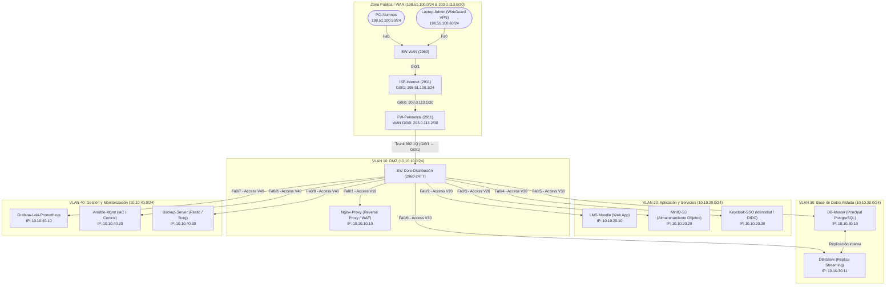

# Proyecto de Fin de Grado (ASIR)
## Plataforma de Cursos Online de Alta Disponibilidad
### Documento Técnico: Arquitectura de Red, Diagrama y Configuraciones IOS

---

## 1. Resumen Ejecutivo de la Infraestructura de Red

El presente diseño implementa la arquitectura de red y seguridad perimetral para una plataforma LMS orientada a alta disponibilidad y tolerancia a fallos. La red está segmentada en cuatro Zonas de Seguridad / VLANs independientes mediante un modelo de enrutamiento **Router-on-a-Stick** con etiquetado IEEE 802.1Q en el cortafuegos perimetral, aplicando principios estrictos de **Zero Trust** y **mínimo privilegio (Least Privilege)**.

- **Archivo de Packet Tracer:** `TFG_ASIR_Plataforma_HA.pkt` (ubicado en esta misma carpeta).
- **Modelo de Firewall/Router:** Cisco 2911 ISR (emulación del appliance pfSense/OPNsense en producción).
- **Modelo de Switch Core/Distribución:** Cisco Catalyst 2960-24TT.

---

## 2. Diagrama de Topología de Red



---

## 3. Plan Maestro de Direccionamiento IP y Conexiones Físicas

| Dispositivo | Interfaz | Subred / Rol | Dirección IP / Prefijo | Gateway | VLAN / Modo |
| :--- | :--- | :--- | :--- | :--- | :--- |
| **ISP-Internet** | Gi0/0 | Enlace WAN punto a punto | `203.0.113.1/30` | - | Routed |
| **ISP-Internet** | Gi0/1 | Red pública simulada | `198.51.100.1/24` | - | Routed |
| **PC-Alumnos** | Fa0 | Alumno externo (Internet) | `198.51.100.50/24` | `198.51.100.1` | Access (SW-WAN Fa0/1) |
| **Laptop-Admin** | Fa0 | SysAdmin Remoto (VPN) | `198.51.100.60/24` | `198.51.100.1` | Access (SW-WAN Fa0/2) |
| **FW-Perimetral** | Gi0/0 | WAN Externa hacia ISP | `203.0.113.2/30` | `203.0.113.1` | Routed |
| **FW-Perimetral** | Gi0/1.10 | Gateway Subinterfaz DMZ | `10.10.10.1/24` | - | dot1Q 10 |
| **FW-Perimetral** | Gi0/1.20 | Gateway Subinterfaz AppLAN | `10.10.20.1/24` | - | dot1Q 20 |
| **FW-Perimetral** | Gi0/1.30 | Gateway Subinterfaz DataLAN| `10.10.30.1/24` | - | dot1Q 30 |
| **FW-Perimetral** | Gi0/1.40 | Gateway Subinterfaz MgmtLAN| `10.10.40.1/24` | - | dot1Q 40 |
| **SW-Core** | Gi0/1 | Troncal 802.1Q hacia FW | - | - | Trunk (10, 20, 30, 40) |
| **Nginx-Proxy** | Fa0 | Reverse Proxy / WAF | `10.10.10.10/24` | `10.10.10.1` | Access VLAN 10 (Fa0/1) |
| **LMS-Moodle** | Fa0 | Aplicación Web LMS | `10.10.20.10/24` | `10.10.20.1` | Access VLAN 20 (Fa0/2) |
| **MinIO-S3** | Fa0 | Object Storage S3 | `10.10.20.20/24` | `10.10.20.1` | Access VLAN 20 (Fa0/3) |
| **Keycloak-SSO** | Fa0 | Identidad y Autenticación | `10.10.20.30/24` | `10.10.20.1` | Access VLAN 20 (Fa0/4) |
| **DB-Master** | Fa0 | PostgreSQL Master | `10.10.30.10/24` | `10.10.30.1` | Access VLAN 30 (Fa0/5) |
| **DB-Slave** | Fa0 | PostgreSQL Standby Réplica| `10.10.30.11/24` | `10.10.30.1` | Access VLAN 30 (Fa0/6) |
| **Grafana-Loki** | Fa0 | Prometheus / Grafana / Loki| `10.10.40.10/24` | `10.10.40.1` | Access VLAN 40 (Fa0/7) |
| **Ansible-Mgmt** | Fa0 | Nodo de Control Ansible | `10.10.40.20/24` | `10.10.40.1` | Access VLAN 40 (Fa0/8) |
| **Backup-Server** | Fa0 | Servidor Restic/Borg | `10.10.40.30/24` | `10.10.40.1` | Access VLAN 40 (Fa0/9) |

---

## 4. Matriz de Control de Tráfico y Políticas de Seguridad (ACLs)

Las reglas implementadas en el firewall siguen el principio de **denegación por defecto (implicit deny)**:

| Origen | Destino | Protocolo / Puerto | Acción | Objetivo de Seguridad |
| :--- | :--- | :--- | :--- | :--- |
| **Internet / Alumnos** | DMZ (`Nginx-Proxy`) | TCP 80, 443 | **PERMITIR** | Publicación segura de la plataforma web sin exponer capas internas. |
| **DMZ (`Nginx-Proxy`)** | AppLAN (`LMS`, `MinIO`, `Keycloak`) | TCP 80, 443, 8080, 9000, 8443 | **PERMITIR** | Balanceo y reverse proxy hacia microservicios backend. |
| **DMZ (`Nginx-Proxy`)** | DataLAN (`DB-Master`, `DB-Slave`) | Cualquier puerto | **DENEGAR** | Si el proxy web se ve comprometido, no hay acceso a las bases de datos. |
| **DMZ (`Nginx-Proxy`)** | MgmtLAN | Cualquier puerto | **DENEGAR** | Aislamiento total de la red de administración. |
| **AppLAN (`LMS-Moodle`)** | DataLAN (`DB-Master`) | TCP 5432 (Postgres) / 3306 (MySQL) | **PERMITIR** | Persistencia transaccional de datos del curso y calificaciones. |
| **AppLAN** | MgmtLAN | Cualquier puerto | **DENEGAR** | Los contenedores de aplicaciones no pueden comunicarse con monitorización ni backups. |
| **DataLAN** | WAN / Internet | Cualquier puerto | **DENEGAR** | Mitigación de fuga de información (exfiltración) y ataques directos externos. |
| **DataLAN (`DB-Master`)** | DataLAN (`DB-Slave`) | TCP 5432 / 3306 | **PERMITIR** | Réplica continua de base de datos para alta disponibilidad y conmutación. |
| **MgmtLAN** | Todas las VLANs | TCP 22 (SSH), 9100 (Node Exporter), ICMP | **PERMITIR** | Recolección de métricas Prometheus, orquestación Ansible y respaldos programados. |
| **VPN WireGuard (Admin Remoto)** | MgmtLAN & Consolas | Puerto túnel seguro | **PERMITIR** | Acceso administrative remoto cifrado sin exponer puertos de gestión a Internet. |

---

## 5. Configuraciones Cisco IOS Utilizadas

### 5.1. FW-Perimetral (Router-on-a-Stick + Hardening + ACLs)

```cisco
! ==============================================================================
! DISPOSITIVO: FW-Perimetral (Cisco 2911)
! ROL: Cortafuegos perimetral y Gateway Inter-VLAN (pfSense equivalente)
! ==============================================================================
enable
configure terminal

hostname FW-Perimetral

! --- BASTIONADO (HARDENING) DE ACCESO Y SEGURIDAD ---
service password-encryption
enable secret cisco123
banner motd #ACCESO RESTRINGIDO - TFG ASIR FW-PERIMETRAL LMS#

username admin privilege 15 secret asir2026
ip domain-name asir.lab
crypto key generate rsa modulus 1024
ip ssh version 2

line console 0
 login local
 exit

line vty 0 4
 transport input ssh
 login local
 exit

! --- INTERFAZ WAN HACIA ISP ---
interface GigabitEthernet0/0
 description ENLACE_WAN_ISP
 ip address 203.0.113.2 255.255.255.252
 no shutdown
 exit

! --- INTERFAZ TRONCAL E INTER-VLAN (ROUTER-ON-A-STICK) ---
interface GigabitEthernet0/1
 description TRUNK_HACIA_SW_CORE
 no ip address
 no shutdown
 exit

! Gateway VLAN 10: DMZ
interface GigabitEthernet0/1.10
 description GW_VLAN10_DMZ
 encapsulation dot1Q 10
 ip address 10.10.10.1 255.255.255.0
 ip access-group 101 in
 no shutdown
 exit

! Gateway VLAN 20: Aplicación y Servicios
interface GigabitEthernet0/1.20
 description GW_VLAN20_APPLAN
 encapsulation dot1Q 20
 ip address 10.10.20.1 255.255.255.0
 ip access-group 102 in
 no shutdown
 exit

! Gateway VLAN 30: Base de Datos Aislada
interface GigabitEthernet0/1.30
 description GW_VLAN30_DATALAN
 encapsulation dot1Q 30
 ip address 10.10.30.1 255.255.255.0
 ip access-group 103 in
 no shutdown
 exit

! Gateway VLAN 40: Gestión y Monitorización
interface GigabitEthernet0/1.40
 description GW_VLAN40_MGMTLAN
 encapsulation dot1Q 40
 ip address 10.10.40.1 255.255.255.0
 no shutdown
 exit

! --- ENRUTAMIENTO ESTÁTICO HACIA INTERNET ---
ip route 0.0.0.0 0.0.0.0 203.0.113.1

! --- LISTAS DE CONTROL DE ACCESO (ACLS EXTENDIDAS) ---

! ACL 101: Filtrado de tráfico entrante desde la DMZ
! Deniega acceso a bases de datos y gestión; permite tráfico hacia AppLAN e Internet
access-list 101 deny ip 10.10.10.0 0.0.0.255 10.10.30.0 0.0.0.255
access-list 101 deny ip 10.10.10.0 0.0.0.255 10.10.40.0 0.0.0.255
access-list 101 permit ip 10.10.10.0 0.0.0.255 10.10.20.0 0.0.0.255
access-list 101 permit ip any any

! ACL 102: Filtrado de tráfico entrante desde AppLAN
! Permite acceso a base de datos para persistencia; deniega acceso a red de gestión
access-list 102 deny ip 10.10.20.0 0.0.0.255 10.10.40.0 0.0.0.255
access-list 102 permit ip 10.10.20.0 0.0.0.255 10.10.30.0 0.0.0.255
access-list 102 permit ip any any

! ACL 103: Aislamiento estricto de DataLAN
! Permite replicación interna y respuestas a App y Mgmt; bloquea salida a Internet
access-list 103 permit ip 10.10.30.0 0.0.0.255 10.10.30.0 0.0.0.255
access-list 103 permit ip 10.10.30.0 0.0.0.255 10.10.20.0 0.0.0.255
access-list 103 permit ip 10.10.30.0 0.0.0.255 10.10.40.0 0.0.0.255
access-list 103 deny ip any any

end
write memory
```

---

### 5.2. SW-Core (Switch Catalyst 2960-24TT)

```cisco
! ==============================================================================
! DISPOSITIVO: SW-Core (Cisco 2960-24TT)
! ROL: Switch de distribución central y segmentación de puertos
! ==============================================================================
enable
configure terminal

hostname SW-Core

! --- BASTIONADO (HARDENING) ---
service password-encryption
enable secret cisco123
banner motd #SWITCH CORE DISTRIBUCION - TFG ASIR#

username admin privilege 15 secret asir2026
ip domain-name asir.lab
crypto key generate rsa modulus 1024
ip ssh version 2

line console 0
 login local
 exit

line vty 0 4
 transport input ssh
 login local
 exit

! --- CREACIÓN DE LA BASE DE DATOS DE VLANS ---
vlan 10
 name DMZ
 exit

vlan 20
 name AppLAN
 exit

vlan 30
 name DataLAN
 exit

vlan 40
 name MgmtLAN
 exit

! --- ENLACE TRONCAL AL FIREWALL PERIMETRAL ---
interface GigabitEthernet0/1
 description UPLINK_TRUNK_FW_PERIMETRAL
 switchport mode trunk
 switchport trunk allowed vlan 10,20,30,40
 no shutdown
 exit

! --- ASIGNACIÓN DE PUERTOS DE ACCESO A SERVIDORES ---

! VLAN 10 (DMZ): Nginx Reverse Proxy / WAF
interface FastEthernet0/1
 description SRV_NGINX_PROXY
 switchport mode access
 switchport access vlan 10
 no shutdown
 exit

! VLAN 20 (AppLAN): Plataforma Web, MinIO y Keycloak
interface FastEthernet0/2
 description SRV_LMS_MOODLE
 switchport mode access
 switchport access vlan 20
 no shutdown
 exit

interface FastEthernet0/3
 description SRV_MINIO_S3
 switchport mode access
 switchport access vlan 20
 no shutdown
 exit

interface FastEthernet0/4
 description SRV_KEYCLOAK_SSO
 switchport mode access
 switchport access vlan 20
 no shutdown
 exit

! VLAN 30 (DataLAN): Clúster de Base de Datos
interface FastEthernet0/5
 description SRV_DB_MASTER
 switchport mode access
 switchport access vlan 30
 no shutdown
 exit

interface FastEthernet0/6
 description SRV_DB_SLAVE_REPLICA
 switchport mode access
 switchport access vlan 30
 no shutdown
 exit

! VLAN 40 (MgmtLAN): Monitorización, Ansible y Backups
interface FastEthernet0/7
 description SRV_MONITORING_GRAFANA_LOKI
 switchport mode access
 switchport access vlan 40
 no shutdown
 exit

interface FastEthernet0/8
 description SRV_ANSIBLE_IAC_MGMT
 switchport mode access
 switchport access vlan 40
 no shutdown
 exit

interface FastEthernet0/9
 description SRV_BACKUP_SERVER
 switchport mode access
 switchport access vlan 40
 no shutdown
 exit

end
write memory
```

---

### 5.3. ISP-Internet (Router WAN Simulado)

```cisco
! ==============================================================================
! DISPOSITIVO: ISP-Internet (Cisco 2911)
! ROL: Simulación del proveedor de servicios de Internet y red pública
! ==============================================================================
enable
configure terminal

hostname ISP-Internet

interface GigabitEthernet0/0
 description ENLACE_P2P_HACIA_FW_PERIMETRAL
 ip address 203.0.113.1 255.255.255.252
 no shutdown
 exit

interface GigabitEthernet0/1
 description RED_PUBLICA_INTERNET_CLIENTES
 ip address 198.51.100.1 255.255.255.0
 no shutdown
 exit

! Ruta estática para alcanzar las subredes privadas a través del Firewall
ip route 10.10.0.0 255.255.0.0 203.0.113.2

end
write memory
```

---

## 6. Pruebas de Impacto y Validación en Directo para la Defensa

Para la exposición ante el Tribunal de ASIR, se recomiendan las siguientes verificaciones ejecutables en directo desde las consolas de Packet Tracer:

### Prueba 1: Demostración del Aislamiento DMZ &rarr; DataLAN
- **Acción:** Desde la consola del servidor `Nginx-Proxy (10.10.10.10)`, ejecutar ping al servidor de base de datos `DB-Master (10.10.30.10)`:
  ```cmd
  ping 10.10.30.10
  ```
- **Resultado esperado:** `Request timed out` (Pérdida del 100%). Demuestra que la ACL 101 bloquea cualquier intento de salto lateral desde la capa web pública hacia los datos.

### Prueba 2: Conectividad Válida Aplicación &rarr; Base de Datos
- **Acción:** Desde el servidor `LMS-Moodle (10.10.20.10)`, ejecutar ping a `DB-Master (10.10.30.10)`:
  ```cmd
  ping 10.10.30.10
  ```
- **Resultado esperado:** Respuestas exitosas (`Reply from 10.10.30.10: bytes=32 time<1ms TTL=254`). Demuestra que la aplicación tiene canal abierto y seguro hacia el motor de persistencia.

### Prueba 3: Conectividad Reverse Proxy &rarr; Aplicación
- **Acción:** Desde `Nginx-Proxy (10.10.10.10)`, ejecutar ping a `LMS-Moodle (10.10.20.10)`:
  ```cmd
  ping 10.10.20.10
  ```
- **Resultado esperado:** Respuestas exitosas (`Reply from 10.10.20.10: bytes=32 time<1ms TTL=254`).

### Prueba 4: Auditoría de Hardening SSH
- **Acción:** Desde cualquier equipo de gestión o cliente, intentar acceder por SSH al router perimetral:
  ```cmd
  ssh -l admin 10.10.40.1
  ```
- **Resultado esperado:** Solicitud de contraseña de usuario local (`asir2026`), despliegue del banner MOTD de advertencia y acceso restringido al nivel privilegiado con `enable secret cisco123`.
